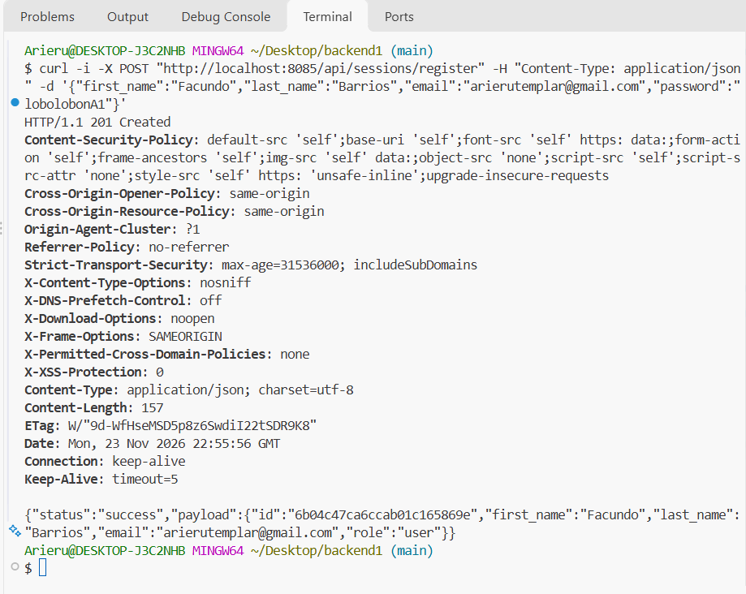
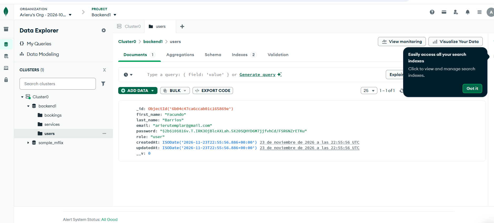

# Plataforma de Eventos e Inscripciones

API REST para una **Plataforma de Eventos e Inscripciones**, con registro seguro de usuarios y arquitectura por capas.

## Temática

Gestión de eventos e inscripciones. En esta etapa se implementa el registro de usuarios; los demás módulos están en preparación.

## Tecnologías

- Node.js
- Express
- MongoDB / Mongoose
- bcrypt
- dotenv
- Helmet
- ECMAScript Modules (ESM)

## Instalación

```bash
git clone https://github.com/Arierutemplar/entregaJS.git
cd entregaJS
npm install
```

## Configuración de variables de entorno

```bash
cp .env.example .env
```

Completar `.env` con:

```env
PORT=8080
NODE_ENV=development
MONGO_URL=mongodb+srv://<usuario>:<password>@<cluster>.mongodb.net/<base_de_datos>?retryWrites=true&w=majority
JWT_SECRET=<clave-larga-y-aleatoria>
JWT_EXPIRES_IN=1h
```

| Variable         | Descripción                                                                 |
| ---------------- | --------------------------------------------------------------------------- |
| `PORT`           | Puerto HTTP del servidor                                                    |
| `NODE_ENV`       | Entorno de ejecución                                                        |
| `MONGO_URL`      | Cadena de conexión a MongoDB Atlas                                          |
| `JWT_SECRET`     | Clave para firmar JWT en entregas posteriores                               |
| `JWT_EXPIRES_IN` | Duración de los JWT (opcional, por defecto `1h`)                            |
| `MONGO_URI`      | Alias aceptado de `MONGO_URL`                                               |
| `DNS_SERVERS`    | Opcional: servidores DNS para conectar con Atlas                            |
| `TEST_MONGO_URL` | Opcional: conexión a una base independiente para las pruebas de integración |

No subir el archivo `.env` al repositorio.

## Cómo ejecutar

```bash
npm run dev
npm start
```

Por defecto: `http://localhost:8080`

## Estructura de carpetas

```text
backend1/
├── docs/evidencias/           # capturas de la entrega
├── test/                      # pruebas (node --test)
├── src/
│   ├── app.js                 # configura Express (no levanta el server)
│   ├── server.js              # levanta el servidor
│   ├── config/
│   ├── routes/
│   │   ├── events.router.js
│   │   └── sessions.router.js
│   ├── controllers/
│   ├── services/
│   ├── repositories/
│   ├── dao/
│   ├── models/
│   │   ├── User.js
│   │   └── Event.js
│   ├── middlewares/
│   └── utils/
├── .env.example
├── .gitignore
├── package.json
└── README.md
```

Flujo de capas:

`routes → controllers → services → repositories → DAO → models`

## Rutas disponibles

### Health

```http
GET /api/health
```

```json
{ "status": "ok", "message": "Servidor activo" }
```

### Events

```http
GET /api/events
```

```json
{ "status": "success", "payload": [] }
```

### Registro de usuarios

```http
POST /api/sessions/register
Content-Type: application/json
```

```json
{
  "first_name": "Ana",
  "last_name": "Pérez",
  "email": "Ana@Mail.com ",
  "password": "Secreta123"
}
```

Los cuatro campos son obligatorios y deben ser cadenas no vacías. El email debe tener formato válido y se guarda sin espacios exteriores y en minúsculas. La contraseña debe tener al menos 8 caracteres y no superar 72 bytes UTF-8 (límite de bcrypt). El rol enviado en el body se ignora: los registros públicos siempre reciben `user`.

Ejemplo de prueba con curl:

```bash
curl -X POST http://localhost:8080/api/sessions/register -H "Content-Type: application/json" -d "{\"first_name\":\"Ana\",\"last_name\":\"Perez\",\"email\":\"Ana@Mail.com \",\"password\":\"Secreta123\"}"
```

Respuesta `201`:

```json
{
  "status": "success",
  "payload": {
    "id": "665f2a000000000000000000",
    "first_name": "Ana",
    "last_name": "Pérez",
    "email": "ana@mail.com",
    "role": "user"
  }
}
```

La respuesta nunca incluye la contraseña; MongoDB almacena únicamente su hash bcrypt. Los datos inválidos producen `400`; un email ya registrado produce `409` con el mensaje `El email ya está registrado`. El índice único de email se inicializa antes de aceptar solicitudes; si la colección existente tiene emails duplicados, deben resolverse antes de arrancar. Los usuarios antiguos con el campo `name` requieren una migración a `first_name` y `last_name`.

### Pruebas

```bash
npm test
```

Las pruebas HTTP verifican validaciones, normalización, rol, hash y duplicados con persistencia simulada. Para probar también la persistencia real, configurar `TEST_MONGO_URL` como variable de entorno apuntando a una base MongoDB de pruebas independiente antes de ejecutar `npm test`. La prueba de integración crea y elimina únicamente su propio usuario. No utiliza automáticamente el archivo `.env`.

### Sesiones pendientes

```http
POST /api/sessions/login
GET  /api/sessions/current
```

La autenticación real (JWT, cookies, Passport, roles) se implementará en entregas siguientes.

## Evidencias

Respuesta del registro, sin `password`:



Usuario en MongoDB Atlas con la contraseña hasheada:


