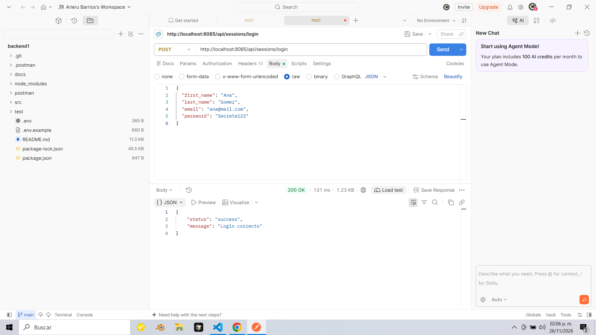
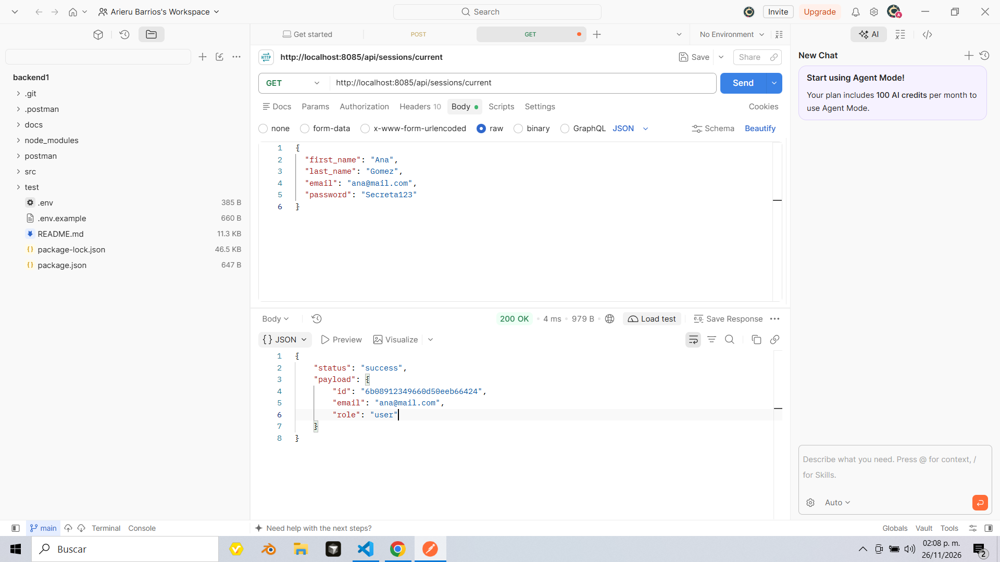
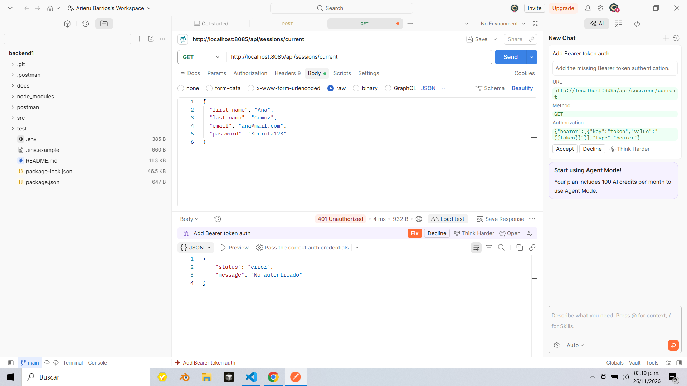
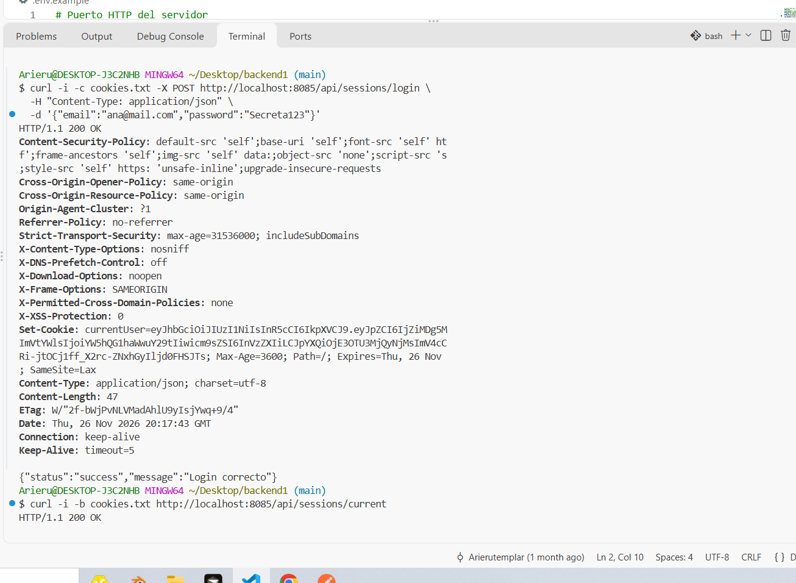

# Plataforma de Eventos e Inscripciones

API REST para una **Plataforma de Eventos e Inscripciones**, con registro seguro, autenticación JWT mediante cookie HttpOnly y arquitectura por capas.

## Temática

Gestión de eventos e inscripciones. En esta etapa se implementan registro y sesiones de usuarios; la persistencia de eventos y las inscripciones están en preparación.

## Tecnologías

- Node.js
- Express
- MongoDB / Mongoose
- bcrypt
- jsonwebtoken
- cookie-parser
- dotenv
- Helmet
- ECMAScript Modules (ESM)

## Instalación

```bash
git clone https://github.com/Arierutemplar/entregaJS.git
cd entregaJS
npm install
```

## Configuración de variables de entorno

```bash
cp .env.example .env
```

Completar `.env` con:

```env
PORT=8080
MONGO_URL=mongodb+srv://<usuario>:<password>@<cluster>.mongodb.net/<base_de_datos>?retryWrites=true&w=majority
JWT_SECRET=<clave-larga-y-aleatoria>
JWT_EXPIRES_IN=1h
NODE_ENV=development
```

La plantilla `.env.example` contiene exactamente esas cinco variables. Las opciones adicionales compatibles se documentan en la tabla: `MONGO_URI` es un alias de conexión, `DNS_SERVERS` permite seleccionar resolutores y `TEST_MONGO_URL` habilita la integración real. No se eliminó su soporte; para las pruebas, exportar las opciones necesarias en el proceso, ya que no cargan `.env`.

| Variable         | Descripción                                                                 |
| ---------------- | --------------------------------------------------------------------------- |
| `PORT`           | Puerto HTTP del servidor                                                    |
| `NODE_ENV`       | Entorno de ejecución                                                        |
| `MONGO_URL`      | Cadena de conexión a MongoDB Atlas                                          |
| `JWT_SECRET`     | Clave secreta larga y aleatoria para firmar y verificar JWT                 |
| `JWT_EXPIRES_IN` | Duración de los JWT (opcional, por defecto `1h`)                            |
| `MONGO_URI`      | Alias aceptado de `MONGO_URL`                                               |
| `DNS_SERVERS`    | Opcional: servidores DNS para conectar con Atlas                            |
| `TEST_MONGO_URL` | Opcional: conexión a una base independiente para las pruebas de integración |

No subir el archivo `.env`, cookies de sesión, credenciales ni `node_modules` al repositorio. `.env.example` contiene únicamente placeholders para secretos y valores de ejemplo no sensibles.

## Cómo ejecutar

```bash
npm run dev
npm start
```

Por defecto: `http://localhost:8080`

## Estructura de carpetas

```text
backend1/
├── docs/evidencias/           # capturas de la entrega (anonimizar antes de publicar)
├── test/                      # pruebas (node --test)
├── src/
│   ├── app.js                 # configura Express (no levanta el server)
│   ├── server.js              # levanta el servidor
│   ├── config/
│   │   ├── database.js        # conexión MongoDB y configuración DNS compartidas
│   │   └── env.config.js      # carga y validación del entorno del servidor
│   ├── routes/
│   │   ├── events.router.js
│   │   ├── health.router.js
│   │   └── sessions.router.js
│   ├── controllers/
│   ├── services/
│   ├── repositories/
│   ├── dao/
│   ├── models/
│   │   ├── User.js
│   │   └── Event.js
│   ├── middlewares/
│   │   ├── auth.middleware.js
│   │   └── error.middleware.js
│   └── utils/
│       ├── hash.js
│       ├── httpError.js
│       └── jwt.js
├── .env.example
├── .gitignore
├── package.json
└── README.md
```

Flujo de capas:

`routes → controllers → services → repositories → DAO → models`

Las rutas solo enlazan middlewares y controladores. Los servicios validan el registro y el login y consultan usuarios a través de repositories y DAO; bcrypt se encapsula en `src/utils/hash.js` y la firma y verificación de JWT en `src/utils/jwt.js`. `src/middlewares/auth.middleware.js` autentica la cookie, mientras los controladores gestionan las respuestas y los flags de cookie. `app.js` configura Express sin lógica de autenticación; `server.js` carga el entorno, conecta MongoDB y comienza a escuchar.

## Rutas disponibles

| Método | Path                     | Descripción                                                |
| ------ | ------------------------ | ---------------------------------------------------------- |
| GET    | `/api/health`            | Estado del servidor                                        |
| GET    | `/api/events`            | Lista inicial de eventos (vacía, sin persistencia todavía) |
| POST   | `/api/sessions/register` | Registro público, siempre con rol `user`                   |
| POST   | `/api/sessions/login`    | Valida credenciales y emite la cookie `currentUser`        |
| GET    | `/api/sessions/current`  | Devuelve el usuario del JWT; requiere cookie válida        |
| POST   | `/api/sessions/logout`   | Elimina la cookie de sesión                                |

Los ejemplos de request y response de cada ruta se detallan a continuación.

### Health

```http
GET /api/health
```

```json
{ "status": "ok", "message": "Servidor activo" }
```

### Events

```http
GET /api/events
```

```json
{ "status": "success", "payload": [] }
```

### Registro de usuarios

```http
POST /api/sessions/register
Content-Type: application/json
```

```json
{
  "first_name": "Ana",
  "last_name": "Pérez",
  "email": "Ana@Mail.com ",
  "password": "Secreta123"
}
```

Los cuatro campos son obligatorios y deben ser cadenas no vacías. El email debe tener formato válido y se guarda sin espacios exteriores y en minúsculas. La contraseña debe tener al menos 8 caracteres y no superar 72 bytes UTF-8 (límite de bcrypt). El rol enviado en el body se ignora: los registros públicos siempre reciben `user`.

Ejemplo de prueba con curl:

```bash
curl -X POST http://localhost:8080/api/sessions/register -H "Content-Type: application/json" -d "{\"first_name\":\"Ana\",\"last_name\":\"Perez\",\"email\":\"Ana@Mail.com \",\"password\":\"Secreta123\"}"
```

Respuesta `201`:

```json
{
  "status": "success",
  "payload": {
    "id": "665f2a000000000000000000",
    "first_name": "Ana",
    "last_name": "Pérez",
    "email": "ana@mail.com",
    "role": "user"
  }
}
```

La respuesta nunca incluye la contraseña; MongoDB almacena únicamente su hash bcrypt. Los datos inválidos producen `400`; un email ya registrado produce `409` con el mensaje `El email ya está registrado`. El índice único de email se inicializa antes de aceptar solicitudes; si la colección existente tiene emails duplicados, deben resolverse antes de arrancar. Los usuarios antiguos con el campo `name` requieren una migración a `first_name` y `last_name`.

### Login

```http
POST /api/sessions/login
Content-Type: application/json
```

```json
{ "email": " Ana@Mail.com ", "password": "Secreta123" }
```

Respuesta `200`:

```json
{ "status": "success", "message": "Login correcto" }
```

Email y contraseña deben ser cadenas no vacías, el email debe tener formato válido y la contraseña no debe superar 72 bytes UTF-8. Los datos ausentes o inválidos producen `400`. Se normaliza el email y se compara la contraseña con bcrypt. Un usuario inexistente o una contraseña incorrecta producen exactamente la misma respuesta `401`:

```json
{ "status": "error", "message": "Credenciales inválidas" }
```

El JWT se firma con HS256 usando `JWT_SECRET`, con expiración `JWT_EXPIRES_IN` (por defecto `1h`). Sus únicos datos de usuario son `id`, `email` y `role`, más los claims temporales `iat` y `exp`; nunca contiene `password`. Se entrega exclusivamente en la cookie `currentUser`: `HttpOnly`, `SameSite=Lax`, ruta `/`, `maxAge: 3600000` (una hora) y `Secure` cuando `NODE_ENV=production`. En producción se necesita HTTPS. La duración de la cookie sigue siendo una hora aunque se configure otra expiración del JWT.

### Sesión actual

```http
GET /api/sessions/current
Cookie: currentUser=<JWT-obtenido-en-login>
```

Respuesta `200`:

```json
{
  "status": "success",
  "payload": {
    "id": "665f2a000000000000000000",
    "email": "ana@mail.com",
    "role": "user"
  }
}
```

El middleware de autenticación verifica firma, algoritmo, expiración y datos del token y asigna el usuario a `req.user`. Sin cookie o con token inválido, manipulado o expirado responde `401`:

```json
{ "status": "error", "message": "No autenticado" }
```

### Logout

```http
POST /api/sessions/logout
Cookie: currentUser=<JWT-obtenido-en-login>
```

No requiere body ni una sesión válida. Elimina `currentUser` con los mismos flags de ruta, HttpOnly, SameSite y Secure del login. Respuesta `200`:

```json
{ "status": "success", "message": "Sesión cerrada" }
```

El logout elimina la cookie del cliente; no revoca copias del JWT, que siguen siendo válidas hasta su expiración. La autorización por roles se incorporará en una entrega posterior.

### Verificación con curl

Con el servidor iniciado y el usuario del ejemplo registrado, ejecutar en Bash/Git Bash. El archivo temporal contiene la cookie de sesión: no compartirlo ni subirlo al repositorio.

```bash
COOKIE_JAR=$(mktemp)
trap 'rm -f "$COOKIE_JAR"' EXIT
curl -i http://localhost:8080/api/health
curl -i http://localhost:8080/api/events
curl -i -c "$COOKIE_JAR" -X POST http://localhost:8080/api/sessions/login -H "Content-Type: application/json" -d '{"email":"Ana@Mail.com","password":"Secreta123"}'
curl -i -b "$COOKIE_JAR" http://localhost:8080/api/sessions/current
curl -i -b "$COOKIE_JAR" -c "$COOKIE_JAR" -X POST http://localhost:8080/api/sessions/logout
curl -i -b "$COOKIE_JAR" http://localhost:8080/api/sessions/current
curl -i http://localhost:8080/api/sessions/current
curl -i -H "Cookie: currentUser=token-manipulado" http://localhost:8080/api/sessions/current
curl -i -X POST http://localhost:8080/api/sessions/login -H "Content-Type: application/json" -d '{"email":"inexistente@example.com","password":"Secreta123"}'
curl -i -X POST http://localhost:8080/api/sessions/login -H "Content-Type: application/json" -d '{"email":"Ana@Mail.com","password":"Incorrecta123"}'
rm "$COOKIE_JAR"
trap - EXIT
```

Health, events, login, current autenticado y logout devuelven `200`; current después de logout, sin cookie o con token manipulado y los dos logins con credenciales incorrectas devuelven `401`.

### Pruebas

```bash
npm test
```

Las pruebas HTTP verifican health, la lista inicial de eventos, rutas inexistentes (`404`), JSON inválido, el límite del parser (`413`) y errores internos, además de validaciones, normalización, rol, hash y duplicados con persistencia simulada. También cubren registro → login → current → logout → current, credenciales incorrectas, cookies ausentes, JWT manipulados o expirados y flags de cookie en producción. Las pruebas de sesiones generan una clave JWT temporal y verifican la expiración por defecto y configurable sin leer ni modificar `.env`.

Para probar también la persistencia real, configurar `TEST_MONGO_URL` como variable de entorno apuntando a una base MongoDB de pruebas independiente antes de ejecutar `npm test`. La prueba de integración crea y elimina únicamente su propio usuario. No utiliza automáticamente el archivo `.env`. Reutiliza los helpers de conexión y desconexión de `src/config/database.js`, por lo que aplica los mismos DNS que el servidor: `DNS_SERVERS` exportada en el proceso o, por defecto, `1.1.1.1,8.8.8.8`. Si `TEST_MONGO_URL` no está definida, se omite la integración; si está definida y la conexión falla, la prueba falla sin ocultar el error.

### Middlewares globales

En `src/app.js`, después de registrar las rutas, se montan `notFoundHandler` y `errorHandler` desde `src/middlewares/error.middleware.js`. Las rutas inexistentes devuelven `404` en JSON. El manejador de errores de cuatro argumentos conserva estados HTTP de error válidos (`statusCode` o `status`) y usa `500` por defecto; también controla errores del parser y de validación. Los errores `5xx` se registran en el servidor y sus detalles internos no se exponen en producción; los mensajes de validación se reemplazan por un mensaje genérico en ese entorno.

Con el servidor iniciado, verificar una ruta inexistente:

```bash
curl -i http://localhost:8080/api/no-existe
```

En Windows PowerShell, usar `curl.exe -i http://localhost:8080/api/no-existe` para evitar el alias de PowerShell. La respuesta debe tener estado `404` y este cuerpo:

```json
{ "status": "error", "message": "Ruta no encontrada: GET /api/no-existe" }
```

## Evidencias

Las capturas utilizan el puerto `8085`; el puerto del servidor depende de `PORT`.

### Login correcto (`200`)



### Sesión autenticada (`200`)



### Sesión sin autenticación (`401`)



### Flujo de sesiones con curl



## Revisión antes de commits y push

```bash
npm test
git status --short
git diff --check
git diff --stat
git check-ignore -v .env node_modules cookies.txt
```

Después de seleccionar los archivos para el commit, revisar también el contenido preparado:

```bash
git diff --cached --check
git diff --cached --stat
git diff --cached
git status
```

La integración real se omite si no se exporta `TEST_MONGO_URL`; una suite en verde con esa prueba omitida no verifica la conexión autenticada con Atlas. Antes del push, completar la anonimización pendiente de evidencias y comprobar que no se incluyan secretos ni archivos temporales, incluso en capturas.
